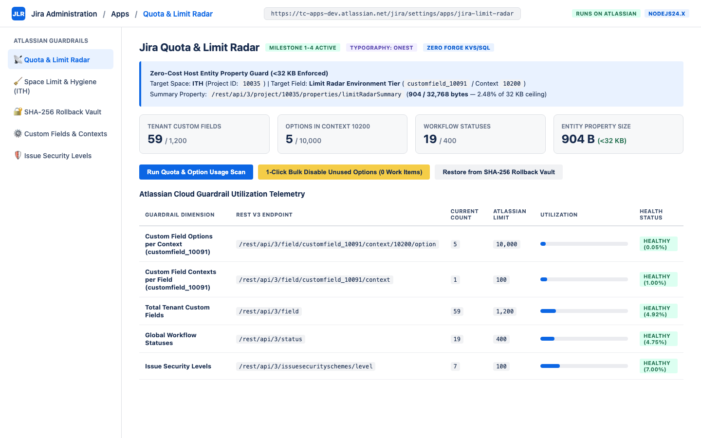
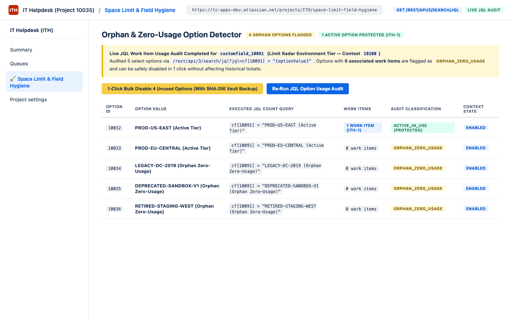
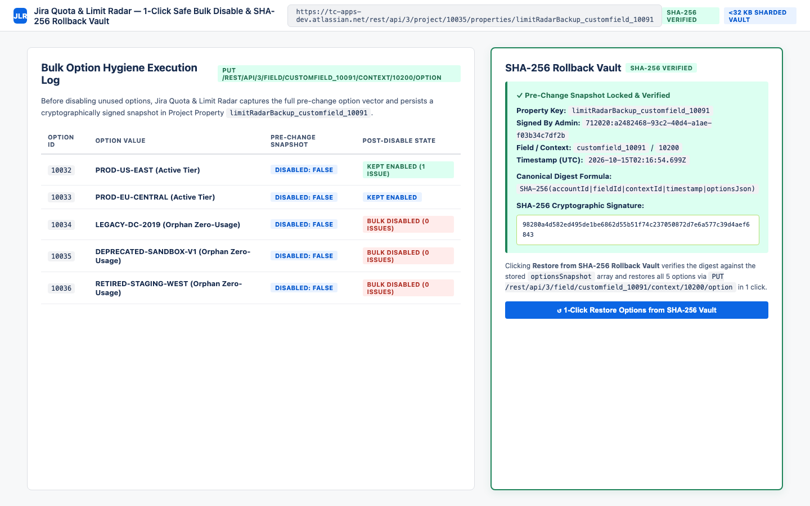

# Jira Quota & Limit Radar — Administrator User Guide

**App Name**: Jira Quota & Limit Radar  
**App Key**: `com.evidencepair.jira.limit.radar`  
**App ID**: `ari:cloud:ecosystem::app/29570e2c-492a-461e-b5fc-ce8b493a1e8f`  
**Platform**: Atlassian Forge (`nodejs24.x`) — 100% *Runs on Atlassian* (Zero Data Egress)

---

## 1. Overview

**Jira Quota & Limit Radar** equips Jira Cloud and Jira Service Management administrators with real-time Atlassian Cloud guardrail observability and safe custom field option hygiene:

1. **Quota & Guardrail Scanner (`jira:adminPage` & `jira:projectPage`)**: Scans custom fields, custom field contexts, option counts per context, global workflow statuses, and issue security levels against official Atlassian Cloud guardrails.
2. **Orphan & Zero-Usage Option Detector (`/rest/api/3/search/jql`)**: Audits every option inside a custom select field context using live JQL work item queries (`cf[id] = "Option Value"`) to pinpoint unused `0`-issue options.
3. **1-Click Safe Bulk Disable & SHA-256 Rollback Vault**: Automatically records a cryptographically signed SHA-256 pre-change option snapshot in Jira Project Properties (`limitRadarBackup_{fieldId}`) before bulk-disabling unused options, enabling 1-click verified restore at any time.

---

## 2. Scanning Atlassian Cloud Guardrails

### Global Admin View (`Jira Settings -> Apps -> Quota & Limit Radar`)
### Project View (`Project Settings -> Space Limit & Field Hygiene`)



Click **Run Quota & Option Usage Scan** to evaluate your tenant against Atlassian Cloud guardrails:
- **Custom Field Options per Context**: Monitored against the `10,000` options/context guardrail.
- **Custom Field Contexts per Field**: Monitored against the `100` contexts/field guardrail.
- **Total Tenant Custom Fields**: Monitored against the `1,200` custom fields guardrail.
- **Global Workflow Statuses**: Monitored against the `400` statuses guardrail.
- **Issue Security Levels**: Monitored against the `100` security levels guardrail.

All scan summaries are stored natively in Jira Project Property `limitRadarSummary` with strict `<32 KB` (`32,768` bytes) payload enforcement.

---

## 3. Auditing Orphan & Zero-Usage Custom Field Options



- For each option in the selected custom field context, Jira Quota & Limit Radar executes a live JQL work item check via `GET /rest/api/3/search/jql`.
- Options referenced by `>= 1` work items are marked **`ACTIVE_IN_USE`** and protected from bulk disabling.
- Options referenced by `0` work items are flagged **`ORPHAN_ZERO_USAGE`**.

---

## 4. 1-Click Safe Bulk Disable & SHA-256 Rollback Vault



1. Click **1-Click Bulk Disable Unused Options (0 Work Items)**.
2. Before modifying any option, the app computes a deterministic SHA-256 hash over:
   ```text
   SHA-256(accountId + "|" + fieldId + "|" + contextId + "|" + timestamp + "|" + optionsJson)
   ```
3. The pre-change snapshot is stored in `limitRadarBackup_{fieldId}` (`<32 KB` enforced).
4. Unused options are bulk-disabled (`"disabled": true`) via `PUT /rest/api/3/field/{fieldId}/context/{contextId}/option` so they no longer clutter issue creation screens while preserving historical ticket data.
5. To revert, click **Restore from SHA-256 Rollback Vault**—the app verifies the SHA-256 digest (`SHA-256 VERIFIED`) and restores all options to their exact previous state in 1 click.

---

## 5. Support & Contact
For technical support or security inquiries, contact **EvidencePair LLC** at `support@titlecovenant.com`.
